# Built on Broken Assumptions (BOBA): Why Coding Agents Cannot Be Left Alone

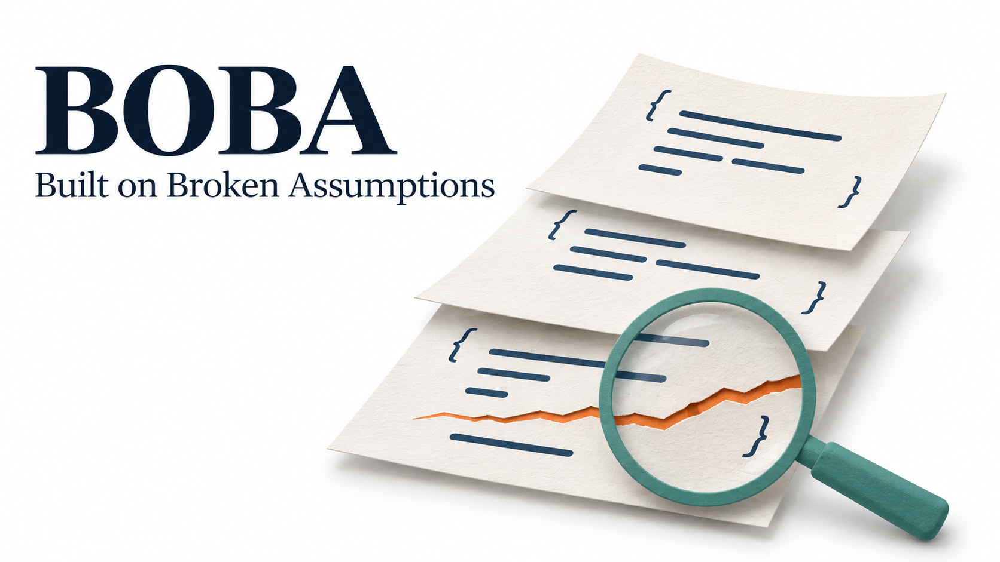

*生成图：以代码层叠、底层裂隙与检查镜表现连续开发和验证的关系，仅作概念示意。*

## 1. 论文信息

| 项目 | 内容 |
|------|------|
| **标题** | Built on Broken Assumptions (BOBA): Why Coding Agents Cannot Be Left Alone |
| **作者** | Alejandro Cuadron、Arpit Gupta（Amazon） |
| **发表时间** | 2026-11-01 |
| **来源** | arXiv预印本，v1|
| **论文地址** | [arXiv](https://arxiv.org/abs/2611.02207v1)；|
| **开源代码** | [BOBA-bench](https://github.com/amazon-agi/BOBA-bench) |
| **研究领域** | Coding Agent评测、连续开发、外部验证、过程可靠性 |

> **总结：** 本文研究Coding Agent在连续开发中如何受到此前错误的影响。作者从140个真实Python仓库构造280条需求链，每条包含20个连续需求。评测保留此前修改形成的仓库状态，每个需求开启新对话，隐藏测试逐步检查结果，但不向Agent反馈。十个模型平均最终完成约51%的链，全程每步正确且无回归的比例约39%。对照实验表明，经过验证的Agent代码与开发者代码作为后续开发基础时表现接近；未被发现的错误则显著增加后续需求的失败风险。外部失败提示和一轮修复能够提高最终完成率，但也会增加回归与调用成本。

## 2. 研究背景与问题

### 2.1 研究背景

Coding Agent已经能够接收需求、修改代码并运行测试。实际使用时，用户还可能连续交给它多个需求，让后一次修改建立在前一次的结果上。如果Agent漏掉某个边界条件，却根据自己编写的测试判断任务已完成，后续开发就会继续使用这份有问题的代码。

单任务评测通常从人类维护的仓库状态出发，给出一个Issue，再用隐藏测试检查补丁。失败会计入分数，但失败代码通常不会作为下一个任务的输入。因此，这类评测难以反映错误在连续开发中的影响。

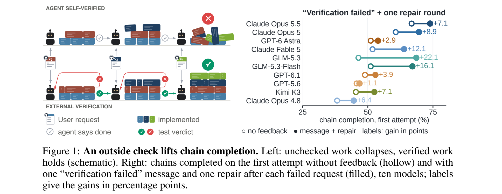

*图1：原论文Figure 1。左侧为概念示意，右侧比较首次尝试中，无反馈与失败提示加一轮修复的链完成率。*

BOBA将此前代码的状态保留下来，观察Agent在没有外部反馈时如何继续开发。这里的“没有外部反馈”不等于不允许运行测试：Agent仍可执行已有测试、编写自己的测试，只是无法知道这些检查是否遗漏了错误。

### 2.2 核心问题

- **问题定义**：单次完成编程需求的能力，能否转化为连续完成一组需求的可靠性？
- **机制区分**：后续开发失败，主要源于Agent代码不适合维护，还是源于此前的错误没有被发现？
- **验证作用**：模型自检、另一个模型审查，以及外部验证反馈，分别能提供多大帮助？
- **评测意义**：如何同时记录最终成功、过程失败、回归和修复成本？

理解本文需要区分功能正确性、错误发现和过程可靠性。隐藏测试通过表示实现满足论文定义的测试要求；Agent声称完成则是它自己的判断。最终状态正确，也不意味着此前每一步都正确。论文通过逐步记录隐藏测试结果，将这些情况分开统计。

### 2.3 相关工作

| 方向 | 代表工作或评测设置 | 与本文的关系 |
|------|-------------------|--------------|
| 单任务仓库评测 | SWE-bench等Issue修复基准 | BOBA保留失败代码，继续观察后续需求 |
| 连续开发评测 | SWE-Chain、SWE-Milestone、SlopCodeBench等 | BOBA进一步区分代码作者与验证状态，并在失败后继续评测 |
| 操作边界评测 | SWE-MISBEHAVIOR | 前者关注越界操作与副作用，BOBA关注功能错误及其后续影响 |

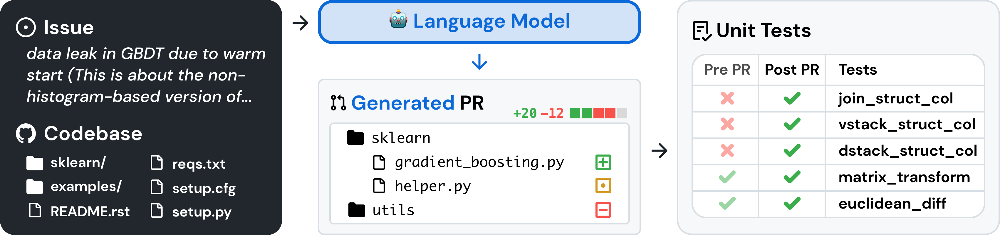

*图中以Issue和仓库为输入，生成补丁后用测试检查结果，用于理解单任务评测*

连续任务本身并不是本文首次提出的设置。作者强调的区别在于，既要允许Agent在错误状态上继续开发，又要通过独立测试区分“代码由Agent编写”与“代码中存在未解决错误”这两个因素。

## 3. 核心贡献

1. 构建BOBA-Bench：从140个真实Python仓库的历史变更中提取280条需求链，每条20步，共5,600个需求位置，对应4,404个唯一需求。
2. 设计连续开发评测协议：仓库状态持续保留，每次需求使用新对话，隐藏测试累计检查，结果不向Agent反馈，失败后仍继续执行后续需求。
3. 通过已验证代码对照、错误状态下的继续开发、交叉模型审查和外部修复实验，分析验证条件对连续开发的影响。
4. 同时报告最终成功率、严格过程成功率和回归率，揭示仅看最终状态容易遗漏的过程故障。

作者将主要性能下降归因于未被发现的错误。实验较有力地支持了验证状态的重要性，但不同机制实验的模型和样本范围并不完全一致，因此还不能将全部链级损失归结为单一原因。

## 4. 方法设计

### 4.1 整体架构

BOBA分为需求链构造和Agent评测两部分。前者从真实提交历史生成需求说明与隐藏测试，后者在同一个仓库中依次执行需求，并由独立评测器记录每一步的测试结果。

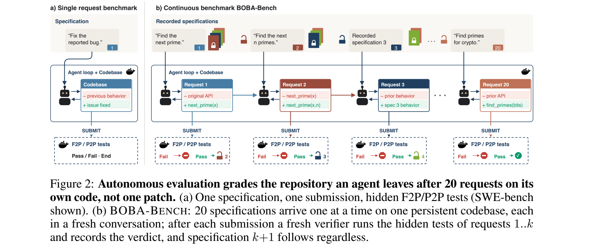

*图2：原论文Figure 2。v1图中失败分支保留了旧版停止标记，官方README已说明这一绘图问题。正文§3.2规定：隐藏测试失败后，仍继续下一个需求。*

设第$k$个需求为$q_k$，此前步骤留下的仓库状态为$S_{k-1}$，则一次修改可以表示为：

$$
S_k=A(S_{k-1},q_k).
$$

其中，$A$包含模型、工具和Harness组成的执行系统。此前若干需求完成后形成的仓库代码，原文称为**代码前缀（prefix）**；例如，完成前$k-1$个需求后形成的代码，就是第$k$个需求的开发基础。新对话只提供当前需求，不包含此前消息、摘要或测试判定；代码、提交历史和仓库文件则继续保留。Agent也不会被告知自己正在完成一条需求链。

Agent在离线容器中检查代码、修改、测试并提交。独立评测器（grader）在另一容器中接收已提交的git历史，运行第1至第$k$个需求的隐藏测试。当前需求自己的测试失败称为**未察觉的失败（silent miss）**；此前通过的受保护测试在新修改后失败称为**回退（regression）**。[§3.2]

### 4.2 基准构造

**提交段与测试要求**

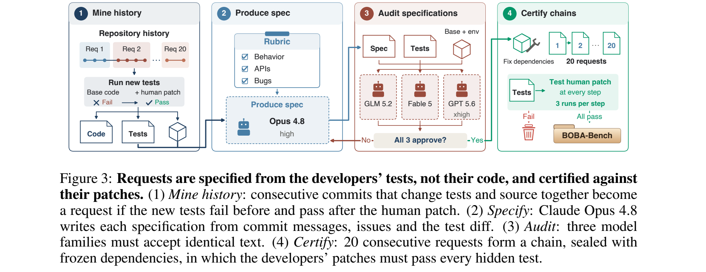

*图3：原论文Figure 3。流程包括历史挖掘、需求生成、需求审计和整链验证。需求说明从测试推导，开发者源码补丁用于验证任务可完成。*

作者提取同时修改源码和测试的连续提交段，将测试变更作为隐藏test patch，其余源码变更作为开发者参考补丁（gold patch）。新增测试需要在修改前失败、加入参考补丁后通过，形成fail-to-pass（F2P）要求；修改前后均通过的测试形成pass-to-pass（P2P）要求。

基础状态与补丁状态分别运行三次，每段至少包含一个F2P测试。跳过、xfail/xpass、执行报错或缺少测试节点都不计为通过。

历史按提交日期遍历，而非只沿first-parent路径。92.3%的边界中，基础提交是目标提交的祖先；另有7.7%跨分支，补丁按两个边界的代码树差异计算。因此，这里的连续历史不完全等于主线上的逐提交复现。[附录D.1，PDF第23页]

**需求说明（specification）与质量审计**

需求生成使用测试差异、提交信息及关联Issue/PR，不提供开发者源码补丁。正文将生成模型概括为Claude Opus 4.8；附录D.6进一步披露，生成过程包含Opus 4.6/4.7/4.8轮转，以及故障时的GLM-5.2人工回退，未逐段记录实际使用的模型。[PDF第26页]

质量检查包括两个阶段：

- **盲解检查**：从开发者此前的代码状态出发，模型只根据需求说明尝试实现，检查文本是否遗漏隐藏测试要求的行为。
- **需求充分性审计**：GLM-5.2、Fable 5和GPT-5.6查看需求、基础代码及隐藏测试，但不看参考补丁。三个模型必须认可同一份文本，否则重写、重审或丢弃。

发布的4,404份需求中，3,183份曾由Opus盲解成功，263份仅GPT成功，886份在该轮均未解出，72份运行不完整。由于后续还重写过部分需求，这些历史分类不能直接作为最终需求的难度标签。[Table 16，PDF第25页]

**数据规模与窗口重叠**

| 阶段 | 唯一需求或提交段 | 仓库数 | 链数 |
|------|-----------------:|-------:|-----:|
| 初始已验证变更段 | 25,519 | 1,491 | — |
| 候选窗口 | 6,740 | 193 | 439 |
| 需求审计后重新划分窗口 | 6,066 | 176 | 397 |
| 最终发布 | 4,404 | 140 | 280 |

每条链包含20个连续需求。历史尾部不足一个完整窗口时，末端窗口会与前一个窗口重叠，因而5,600个需求位置中有1,196次重复出现。论文按仓库聚类进行bootstrap抽样，避免把同仓库、重叠窗口中的记录全部当成独立样本。[附录D.3、D.5]

### 4.3 评测指标

| 指标 | 定义 | 解释 |
|------|------|------|
| pass@1 | 一次尝试最终通过整条链全部测试的概率，按每链八次独立尝试估计 | 中途失败、后来修好，仍可计成功 |
| single attempt | 每条链只取第一次尝试的最终成功率 | 新会话反馈实验使用这一配对基线 |
| strict pass@1 | 每个需求在其对应步骤通过自身测试（on its own step），且全过程无回归 | 后续修复不能消除已经发生的过程失败 |
| regression rate | 至少出现一次回归的链尝试占比 | 后来修好仍计为发生过回归 |
| pass@8 | 八次尝试中至少一次最终成功的链占比 | 反映多次尝试的潜力，不提供实际选择正确结果的方法 |
| request completion | 首次尝试中，全部已评分需求在发出该需求的步骤通过自身测试（on the step they are issued）的比例 | 分母是已评分需求，不一定为5,600 |

“在其对应步骤通过”（on its own step）是指：第$k$个需求在第$k$步提交后的检查中就通过自身测试。如果到后续步骤才修好，就不满足这一要求。pass@1的八次运行是独立尝试，不是八轮修复。没有第20步最终状态的尝试按失败计；strict与regression则按具有过程评分记录的尝试统计。复现时应分别核对这些分母，不能为缺失过程记录自行补造标签。[Table 2；官方仓库指标说明]

摘要中“单独评测请求时约95%”与主表66.2%–84.0%的request completion也不是同一口径。后者来自自主链中的首次尝试，需求可能接在错误代码之后；前者对应单独请求的评测。两组数字不能直接合成同一列。

### 4.4 实验条件

| 条件 | 代码与反馈设置 | 研究目的 |
|------|----------------|----------|
| Autonomous | 在此前代码上继续，不接收隐藏测试判定 | 测量无外部反馈的连续开发 |
| Agent Code | 此前各需求均由Agent实现并通过验证 | 测量已验证Agent代码的后续可维护性 |
| Human Code | 使用开发者参考补丁构成此前状态 | 与Agent代码进行作者身份对照 |
| Silent Continuation | 在未察觉错误的状态上接收下一需求 | 测量错误状态对后续实现的影响 |
| Verified | 错误后提供失败提示，并允许一次修复 | 测量外部反馈的作用 |
| Review | 模型检查实现并决定接受或拒绝 | 测量模型能否提供可靠审查 |

Agent Code和Human Code是同一作者身份对照中的两种条件。不同研究使用的模型和有效样本并不完全一致，具体范围见附录G的Table 28；不能默认主榜十个模型都完成了全部机制实验。

## 5. 实验分析

### 5.1 实验设置

- **数据集**：280条链，来自140个Python仓库，每链20个需求。
- **模型**：十个模型，包括Claude Opus/Fable、GPT、GLM和Kimi系列。
- **运行次数**：每模型每链八次独立尝试，共2,240次链尝试；十模型共22,400次。
- **主实验Harness**：mini-swe-agent 2.4.6。
- **执行预算**：每链累计两小时工具执行时间，不限制模型调用数，也没有整链墙钟时限。工具预算或上下文耗尽仍可导致提前结束。
- **统计方法**：按仓库聚类计算置信区间；模型间比较另使用配对检验和多重比较校正分析。[§3.4，附录D.8、G–H]

### 5.2 主要实验结果

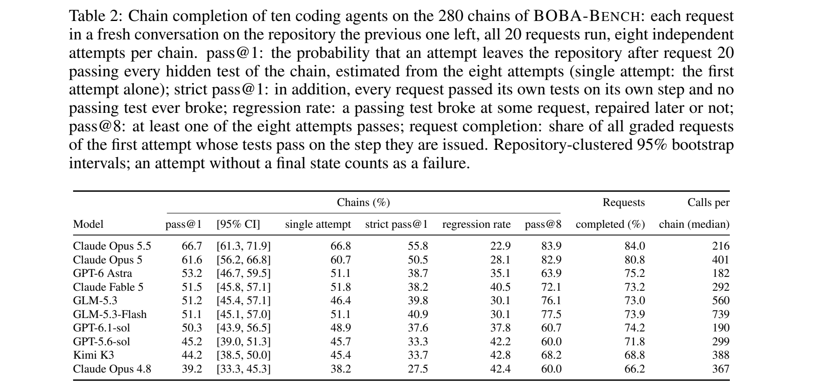

*表2：原论文Table 2。原表保留置信区间、首次尝试结果、逐需求完成率与调用中位数；下表摘录链级指标。*

| 模型 | pass@1 | strict pass@1 | 回归率 | pass@8 |
|------|-------:|--------------:|-------:|-------:|
| Claude Opus 5.5 | 66.7% | 55.8% | 22.9% | 83.9% |
| Claude Opus 5 | 61.6% | 50.5% | 28.1% | 82.9% |
| GPT-6 Astra | 53.2% | 38.7% | 35.1% | 63.9% |
| Claude Fable 5 | 51.5% | 38.2% | 40.5% | 72.1% |
| GLM-5.3 | 51.2% | 39.8% | 30.1% | 76.1% |
| GLM-5.3-Flash | 51.1% | 40.9% | 30.1% | 77.5% |
| GPT-6.1-sol | 50.3% | 37.6% | 37.8% | 60.7% |
| GPT-5.6-sol | 45.2% | 33.3% | 42.2% | 60.0% |
| Kimi K3 | 44.2% | 33.7% | 42.8% | 68.2% |
| Claude Opus 4.8 | 39.2% | 27.5% | 42.4% | 60.0% |

本文统一使用v1数值。官方仓库后续checked snapshot已有小幅更新，例如Opus 5.5为66.4%。

**最终成功与过程稳定性存在差距。** 十模型平均最终完成约51%，严格过程成功率约39%。单模型两者相差约10–15个百分点，23%–43%的链尝试发生过回归。以Opus 5.5为例，最终成功率66.7%，strict为55.8%。只看最后一次提交，无法反映此前版本是否曾经破坏已有行为。

**后续开发较少修复已有错误。** 运行中失败的测试只有14%–33%在后续恢复通过。测试状态恢复可能来自主动修复，也可能是后续任务中的相关修改，仅凭结果无法推断Agent是否意识到了错误。[§4.1，附录F.6、Figure 9]

### 5.3 代码作者与错误状态的对照

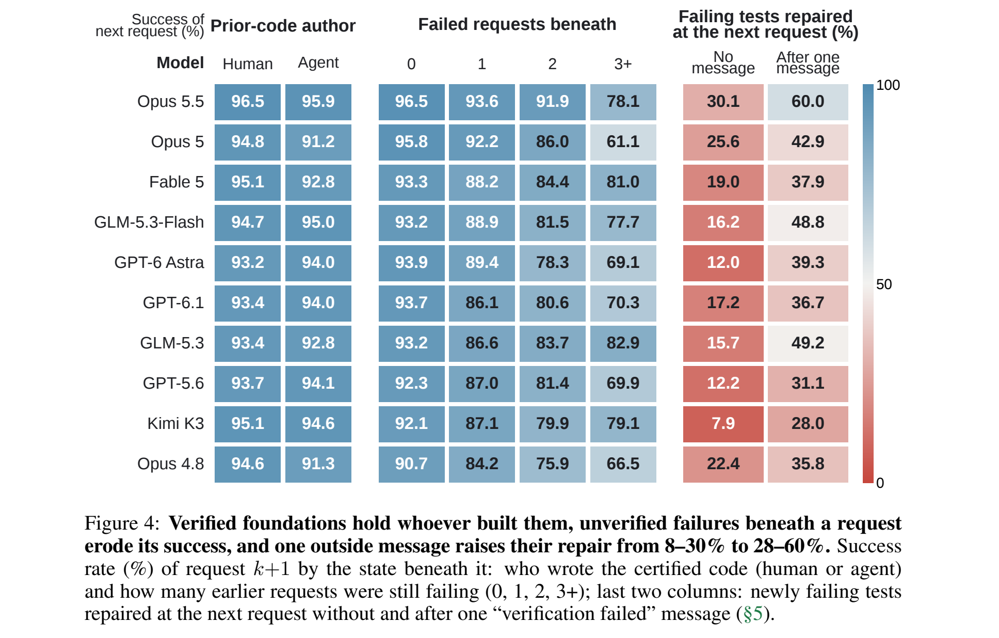

*图4：原论文Figure 4，PDF第7页上部。左侧比较已验证代码的作者；中间按此前仍未通过的需求数分组；右侧统计下一需求之后，新失败测试恢复通过的比例。右侧不是整链完成率。*

**经过验证的Agent代码与开发者代码差距较小。** 作者让同一模型在两种已验证状态上完成同一后续需求：Agent已验证代码（agent’s certified prefix）与开发者代码（human prefix）。这里的“已验证代码前缀”（certified prefix）表示，此前需求形成的代码已经通过相应测试。十一模型中，Agent−Human的成功率差距为−3.6至+0.8个百分点，平均约−1个百分点；其中三个模型的差距区间排除0。[§4.2，附录B]

这说明，至少在论文的测试要求范围内，Agent留下的正确实现并没有普遍成为明显更差的开发基础。但比较只保留两边都有完整可用记录的边界，且不衡量可读性、架构、安全或性能，因此不能直接推广为“Agent代码质量等同于人类代码”。

**未解决错误显著增加后续失败。** 在Silent Continuation中，一次未察觉错误后，下一需求失败率平均增加约18个百分点。作者又将同一后续需求放回开发者状态求解，失败率仍低9–19个百分点，减少了“这些后续需求本来就更难”的解释空间。[§4.2，附录F.3]

随着未解决错误数量增加，下一需求失败风险继续上升。论文用失败赔率约翻倍概括拟合关系，但错误数量也可能与仓库、需求难度相关，不宜将其解释为每增加一个错误就固定造成某个倍数的因果影响。开发者状态对照也只覆盖部分模型和样本。[Table 28]

### 5.4 交叉模型审查

**实验设计**

每个作者模型提供109个错误实现，并配对同一作者在另一轮中对同一需求的正确实现，共1,090对。每个reviewer审查2,180项，十个reviewer合计21,800次判断。审查时隐藏作者身份，不提供隐藏测试，但允许reviewer自行检查与测试。

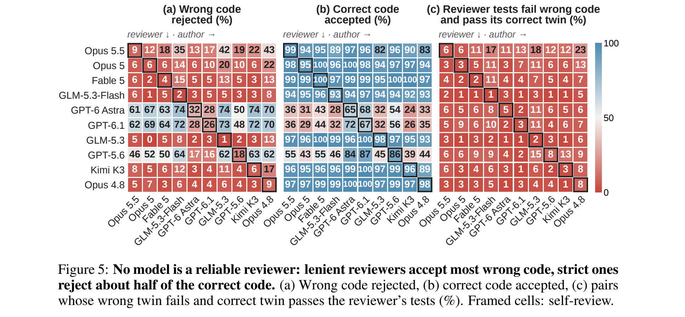

*图5：原论文Figure 5。行表示reviewer，列表示实现作者，方框表示自审。三个面板分别为错误代码拒绝率、正确代码接受率，以及自建测试区分成对实现的比例。*

**判定结果与自建测试**

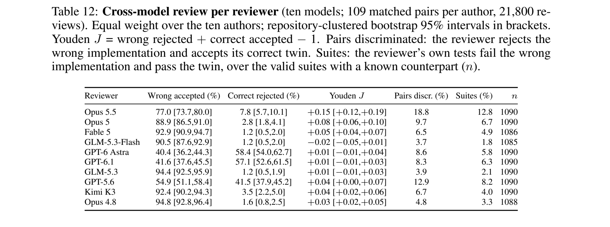

*表12：原论文Table 12，附录C。Pairs discr.统计最终判断能否同时拒绝错误实现、接受同任务的正确实现；Suites统计有效自建测试能否使错误实现失败、正确实现通过。两项指标及其分母不同。*

宽松reviewer接受77%–95%的错误实现；严格reviewer拒绝41%–58%的正确实现。最终判断的配对区分率仅3.7%–18.8%。Youden指标用于综合衡量两类判断：

$$
J=P(\text{拒绝}\mid\text{错误})+P(\text{接受}\mid\text{正确})-1.
$$

如果reviewer几乎一律接受或一律拒绝，$J$都接近0；能够同时识别正确和错误实现时，$J$才会提高。最高点估计为Opus 5.5的0.15，置信区间为[0.12,0.19]。

此外，三个GPT reviewer对自身错误实现的接受率为68%–82%，对其他作者则为37%–52%。作者匿名条件下仍存在自审偏好，但现有证据不足以确定其原因是代码风格相似、共享错误模式还是其他因素。

这些结果表明，在本文提供的代码、工具和上下文条件下，模型审查不足以替代独立功能验证。它们不排除reviewer在可读性检查、风格建议或更充分诊断信息下的价值。

### 5.5 外部验证与修复

**反馈协议**

| 实验 | 会话设置 | 完成指标 | 原文位置 |
|------|----------|----------|----------|
| 连续会话实验（continuous conversation） | 整条链保留同一会话，错误后继续反馈与修复 | 每个需求在相应步骤通过 | 附录K.1–K.5、Table 37等 |
| 新会话交接实验（handoff protocol） | 失败后开启新会话修复，再继续后续需求 | 最终pass@1，另报strict和回归 | 附录K.6、Tables 41–43 |

两套实验的会话记忆、样本和完成标准不同。正文中“一轮修复约三分之一到一半”来自连续会话机制实验，不能直接用来说明主基准的新会话表现。

**一次失败提示的收益与代价**

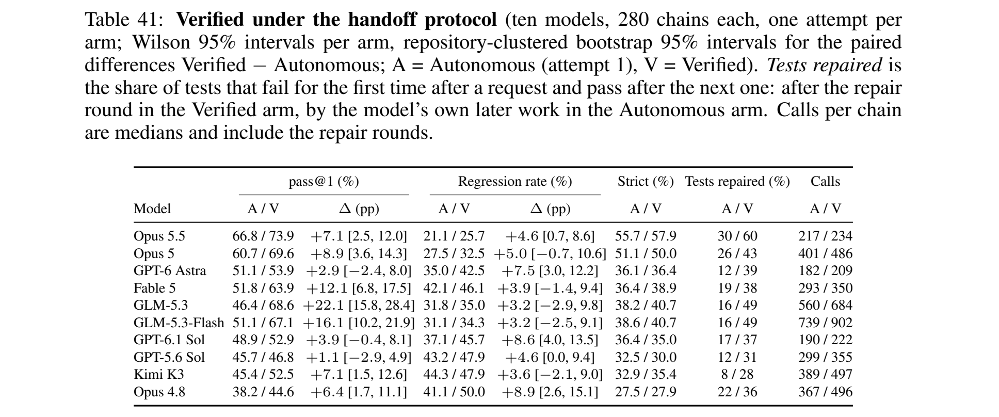

*表41：原论文Table 41，附录K.6。A为无反馈的第一次尝试，V为失败提示加一轮修复；Calls表示包括修复轮在内的每链调用中位数。*

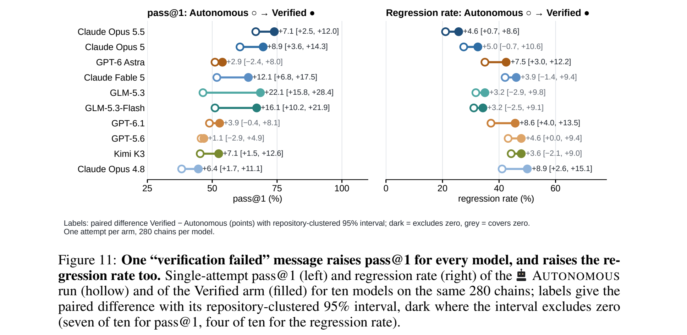

*图11：原论文Figure 11。空心点为无反馈，实心点为增加反馈与修复。左侧成功率有7/10的配对差值区间排除0，右侧回归率有4/10，不能将所有正点估计都视为显著增加。*

在与主基准一致的新会话设置中，作者只提供“verification failed”，再允许一轮修复。最终成功率提高1.1–22.1个百分点，回归率点估计增加3.2–8.9个百分点，strict没有出现相应幅度的提升。

| 模型 | 最终成功率A→V | strict A→V | 回归率A→V | 调用中位数A→V |
|------|---------------:|-----------:|----------:|----------------:|
| Opus 5.5 | 66.8%→73.9% | 55.7%→57.9% | 21.1%→25.7% | 217→234 |
| GPT-6.1 Sol | 48.9%→52.9% | 36.4%→35.0% | 37.1%→45.7% | 190→222 |

这里的基线是第一次尝试，不能改用Table 2的八次均值。strict也不会因为后续修复而抹去此前的步骤失败，因此修复有效并不必然带来strict提升；与此同时，额外修改还可能引入新回归。

正文报告每链额外47–294次调用，但Table 41列的是调用中位数，两列中位数相减并不对应这一范围。估算成本时，需要统一统计量或回到逐次运行记录，避免混用。

**失败信息的具体程度**

论文将反馈方式区分为**仅提示验证失败（Reject）**、**提供失败测试标识（Name）**和**重复失败提示（Insist）**。“具名反馈”对应Name：在失败消息中附上失败测试节点的标识（identifiers of the failing test nodes），给Agent更具体的定位线索。Table 42将仅提示一次的对照称为Reject once；Insist则在每次修复失败后再次发送同一条简单失败提示。

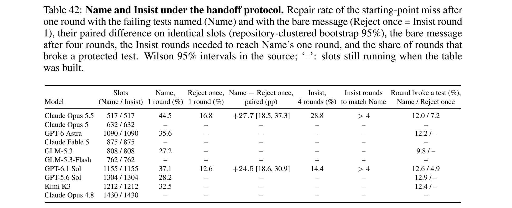

*表42：原论文Table 42，附录K.6。Name提供失败测试名，Reject once只提示验证失败，Insist重复失败提示。“–”表示制表时实验未完成，不能视为零。*

| 模型 | 提供测试名，一轮修复 | 仅失败提示，一轮修复 | 仅失败提示，四轮修复 | 破坏已有测试：测试名／仅提示 |
|------|--------------------:|--------------------:|--------------------:|----------------------------:|
| Opus 5.5 | 44.5% | 16.8% | 28.8% | 12.0%／7.2% |
| GPT-6.1 Sol | 37.1% | 12.6% | 14.4% | 12.6%／4.9% |

完整配对结果表明，给出失败测试名比反复要求“再修一次”更有效。但更具体的反馈也伴随更多破坏已有测试的修复轮。论文将其与更大的修改范围联系起来，这意味着修复之后仍需检查此前行为。

**验证器误报**

作者还让正确提交以概率$p$收到失败提示，测量错误报警的影响。在已完成的新会话实验中，$p=0.1$时，误报修复轮破坏原本通过测试的比例为3.5%–11.4%。Opus 5.5在$p=0.5$时，相对无误报验证器的最终成功率下降9个百分点，区间为[−18,−1]。

这说明验证系统也需要评估准确性。增加反馈可能帮助修复，也可能促使Agent修改本来正确的代码。

### 5.6 Harness敏感性

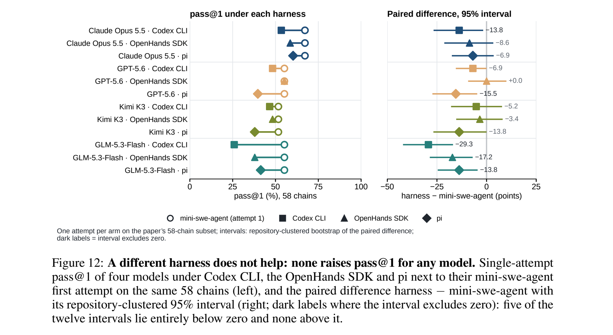

*图12：原论文Figure 12，附录K.7。左侧为各Harness成功率，右侧为相对mini-swe-agent的配对差值与置信区间；完整数值见同页Table 44。*

作者在58条链、52个仓库上，为四个模型分别换用Codex CLI 0.146.1、OpenHands SDK 1.46.0和pi 0.84.2。12组对照中，没有一组提高pass@1；差值为0至−29.3个百分点，其中5个区间完全低于0，其余覆盖0。

这支持“所测替换未改善完成率”，但不能说明Harness整体无关。不同框架的执行约束也未完全一致：累计工具时间无法在所有Harness内直接实施，作者使用单次调用限制替代；pi存在单命令长时间停滞，另有验证器报错，均按失败处理。差值反映的是这些配置组成的完整系统，不能完全归因于模型推理方式。

### 5.7 实验可信度

**统计控制。** 已验证代码的作者对照、同一后续请求在开发者状态上的重跑，有助于区分代码作者、请求难度与错误状态。但不同研究的覆盖范围不同，仍需结合Table 28核对样本，避免将多个局部对照当作一套完整平衡实验。

**排名稳定性。** 附录H主要比较第一次尝试。45个模型对中，McNemar检验和聚类bootstrap各区分26对，二者重合25对；相邻名次仅3/9可区分。Holm校正后，原先26对中只保留17对，第一名与第二名的差异也不再显著。中段排名应结合区间理解。

**数据污染。** 三个Claude模型能近似复现14%–19%的抽样代码块，但作者没有检测到记忆仓库具有更高链完成率。相关区间仍较宽，正确表述是“未检测到可测优势”，而非“已排除污染”。[附录E、Figure 6，PDF第32页]

**需求质量。** 需求生成、审计都依赖隐藏测试，规格与测试并不独立。作者预注册了独立人类审查，但v1未报告结果。现有流程降低了任务不可解或文本缺失的风险，仍不能保证需求覆盖完整用户意图。

## 6. 局限性

### 6.1 作者报告的局限

1. 主要衡量固定测试要求下的功能正确性，不覆盖可读性、架构、安全、性能与生产运维。
2. 数据仅来自Python仓库，固定20步历史变更不能代表所有长期开发任务。
3. 需求说明由模型生成并审计，独立人类充分性标注尚未给出。
4. 公开仓库存在训练污染可能，探针结果的区间不足以排除较大影响。
5. 最终pass@1允许中途失败、最后恢复，因此需要结合strict和回归率分析。

### 6.2 个人发现的问题

**会话设置限制外推。** 每次重开对话移除了消息记忆，但保留仓库记忆。长期会话、项目摘要、人工评审或显式状态记录可能改变结果，需要单独比较。

**需求关联不等于直接依赖。** 附录A报告第2–20步中，73.3%涉及此前引入的符号或模块；扩展到文件、符号或import关联后为98.9%。这些统计说明需求并非相互独立，但20个连续需求不能等同于20层直接依赖。

**已验证代码的比较存在筛选。** 只有两种条件都能形成可用验证记录的边界才进入配对。结果说明这部分正确实现可以支撑后续开发，无法直接衡量所有Agent代码的长期维护质量。

**测试通过与实际风险仍有距离。** 某次回归可能只影响一个边界输入，也可能破坏核心功能。链级二元指标能记录是否发生故障，但不能反映损害程度、持续时间和恢复成本。

### 6.3 待研究问题

- 如何降低对话交接中的信息损失，并使失败证据准确到达修复者？
- 如何在相同成本下比较更具体的反馈与更多修复轮次？
- 如何区分可恢复测试失败与会影响下游用户的严重故障？
- 如何联合评估功能结果、操作边界和验证成本？

## 7. 个人思考

### 7.1 最有价值的研究思路

我认为最值得借鉴的是把验证条件单独控制。直接比较人类代码和Agent代码，很容易将代码来源与正确性混在一起。先确认此前实现通过测试，再比较后续开发能力，可以更清楚地判断问题出在哪里。

另一个收获是同时记录最终状态与过程。strict较严格，最终成功率也有实际意义，两者适合回答不同问题。例如，一条离线生成流程可能允许中间失败；每次修改都要交给下游使用的系统，则更需要关注过程中的正确性和回归。

### 7.2 与其他论文的联系

**与SWE-MISBEHAVIOR的互补。** BOBA关注功能错误未被发现后的连续开发，SWE-MISBEHAVIOR关注执行中的越界操作和副作用。即使最终功能测试通过，Agent仍可能修改无关文件、安装不必要依赖或执行越权操作。两类指标结合，才能同时观察功能结果与操作过程。

**与单任务评测的关系。** 单任务分数可以衡量某次实现能力，但不能直接推出连续开发成功率。即使假设单步成功率为95%，$0.95^{20}\approx35.8\%$也只是独立连乘示例：BOBA中的需求相关、仓库状态变化，且允许后续修复，不能用这一计算替代实验解释。

### 7.3 可能的改进方向

| 改进方向 | 待验证假设 | 实验设计 |
|----------|------------|----------|
| 会话交接 | 部分修复损失来自历史信息缺失 | 固定模型和需求，比较原会话反馈与新会话反馈 |
| 反馈粒度 | 具体失败证据比重复失败提示更有效 | 在相同调用预算下比较失败位、测试名和受影响行为 |
| 修复范围控制 | 大范围修改增加新回归 | 比较自由修复与受影响范围约束，同时记录修改量和回归 |
| 验证资源分配 | 针对未覆盖行为检查可提高成本效率 | 比较固定验证频率与按证据缺口分配验证，保留统一隐藏测试 |

这些是个人提出的实验方向，尚未得到本文验证。尤其是Agent自报的测试覆盖可能与实现共享错误，不能直接用来替代独立评测器。

### 7.4 个人评价

- **创新性**：通过代码作者与验证状态的对照，使连续开发失败的解释更清楚。
- **技术深度**：以基准构造、协议设计和机制实验为主。
- **实验充分性**：覆盖多模型、反馈条件和Harness，但部分实验尚未完成，不同研究的样本也不完全统一。
- **实用价值**：支持保留外部反馈通道，并将最终成功、过程失败和修复代价分别记录。

## 8. 总结

### 核心结论

BOBA表明，单任务能力不足以说明Coding Agent能否可靠地连续开发。经过验证的Agent代码可以支撑后续需求；没有被发现的错误则容易持续存在，并提高后续失败风险。模型审查在所测条件下不足以提供可靠功能验证，外部反馈能够恢复一部分成功率，也会增加回归与成本。

### 收获

评测连续开发时，需要同时记录每步需求是否满足、已有行为是否被破坏、错误何时修复，以及验证与修复消耗多少资源。这些记录比单独的最终成功率更有助于判断系统适合怎样的委托方式。